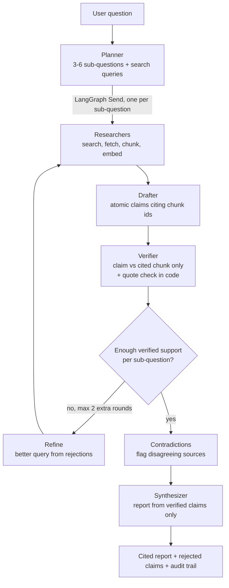

# DeepDive: a self-verifying research analyst

**Agent Arena 2026 · Track 01 (DeepDive).** Ask a research question; get a structured report in
which **every claim has been checked against the exact source text it cites.** Claims the source
doesn't support are removed and listed with the reason, thin areas trigger more research, and
every step of the run is recorded.

Research tools that cite sources already exist. Their known weakness is trust: the cited page
often doesn't say what the sentence claims. DeepDive's focus is making the citations true.

## How the agents cooperate



| Agent | Job | Model (via Mesh API) |
|---|---|---|
| **Planner** | Splits the question into 3-6 non-overlapping sub-questions, each with a web query. On a loop, rewrites the query for thin sub-questions using the rejected claims and their reasons. | `openai/gpt-5-nano` |
| **Researcher** ×N | One per sub-question, in parallel: Tavily search → fetch + extract page text → chunk → embed (through Mesh) → store evidence with its source and quality tier. | `google/embeddinggemma-300m` (embeddings) |
| **Drafter** | Writes **atomic claims**, each citing 1-2 evidence chunk ids. Claims citing ids it wasn't given are dropped. | `openai/gpt-5-nano` |
| **Verifier** | Judges each claim against **only** the chunk it cites and must return a **verbatim quote**. | `anthropic/claude-haiku-5.5` (a different model family from the drafter) |
| **Contradictions** | Flags verified claims that disagree across sources, instead of silently picking one. | `openai/gpt-5-nano` |
| **Synthesizer** | Writes the report **from verified claims only**; any paragraph citing anything else is dropped. | `openai/gpt-5-nano` |

The **coordinator** is the LangGraph `StateGraph` in [`app/graph/build.py`](app/graph/build.py).
Graph state carries only ids and counters; sources, chunks, claims, verdicts and events live in
SQLite, and embeddings live in Chroma.

## What makes the verification trustworthy

1. **Quote check in code** ([`app/tools/quote_match.py`](app/tools/quote_match.py)). The
   verifier's quote must actually appear in the cited chunk: normalized exact match, then fuzzy
   match, and *every number in the quote must appear in the source*. If it doesn't, the claim is
   marked unsupported (`verifier quote not found in source`), so the verifier can't hallucinate
   support either.
2. **Isolated judging.** The verifier sees one claim and its cited text, nothing else.
3. **A real loop with a rule in code** ([`app/graph/rules.py`](app/graph/rules.py)). A
   sub-question with fewer than 2 supported claims goes back to research with a refined query,
   up to 2 extra rounds. If it's still thin, the report says so under *Limited evidence* rather
   than padding.
4. **Drafter ≠ Synthesizer.** The writer of the final prose never sees unverified claims.
5. **Source-quality tiers** (official/academic → major news → other) order the evidence the
   drafter sees and are shown in the report.

## Self-evaluation

`uv run python -m eval.run` researches the 24 questions in [`eval/questions.jsonl`](eval/questions.jsonl)
and measures:

- **Verifier catch rate.** Supported claims are altered (a number, a year, the direction of a
  change, the named entity) and re-verified against the same source. How many fakes are caught?
- **Wrongful rejection rate.** The same supported claims re-verified unaltered (guards against a
  verifier that rejects everything).
- **Independent groundedness.** A judge from a *third* model family (`google/gemini-2.5-flash-lite`)
  re-checks claims cited in final reports, so the verifier isn't grading its own homework.
- **Agreement with hand labels.** 50 claims labelled by hand against their sources (accuracy and
  Cohen's kappa).
- Quote validity, loop rate, sub-question coverage, cost and latency per run.

**Results: [`eval/RESULTS.md`](eval/RESULTS.md)** (also shown on the app's `/eval` page).

## Run it

```bash
uv sync                                   # Python 3.11, dependencies from uv.lock
cp .env.example .env                      # set MESH_API_KEY and TAVILY_API_KEY
uv run python scripts/mesh_smoke.py       # check every configured model answers
uv run uvicorn app.main:create_app --factory --reload   # http://localhost:8000
```

- One question from the terminal: `uv run python -m app.cli "your question"`
- Docker: `docker compose up --build` (data persists in `./data`)
- Tests (no network, no keys): `uv run pytest -q`
- API docs: `/docs` · Live timeline: `/runs/<id>` · Audit trail: `/runs/<id>/trail` (JSON at
  `/api/runs/<id>/trail`)

## Deployment

GitHub Actions → ECR → EC2 (OIDC, no stored AWS keys; deploy through SSM, no SSH), with Caddy for
HTTPS. The public demo is protected by an access code and an hourly run limit. Step-by-step:
[`docs/DEPLOY.md`](docs/DEPLOY.md).

## Project layout

```
app/graph/       LangGraph coordinator, agent nodes, loop rules, runner
app/tools/       quote matching, source tiers, chunking, search, fetch, vector store
app/llm.py       the only place that calls models, always through Mesh API
app/api/         REST + SSE API, HTML pages, access gate
eval/            question set, planted-error generator, judge, metrics, results
docs/            design spec, implementation plan, design notes, deploy runbook
```

Design decisions and trade-offs: [`docs/DESIGN_NOTES.md`](docs/DESIGN_NOTES.md).

## Known limitations

- Single instance: runs execute as in-process background tasks (max 2 at once); no job queue.
- Search depends on Tavily's raw page content, falling back to direct fetching. PDFs and
  paywalled pages are skipped, not read.
- The verifier checks support against the cited chunk, not whether the source itself is correct.
  Source tiers and contradiction flags help, but a wrong official figure stays wrong.
- Eval questions are answered from the live web, so numbers vary between runs. Search results are
  cached to keep re-runs reproducible.
