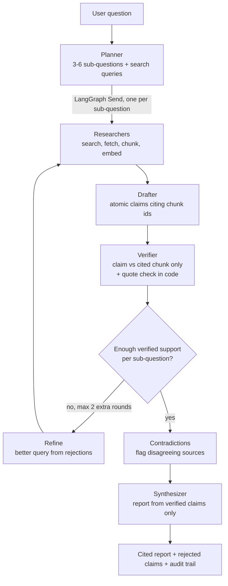
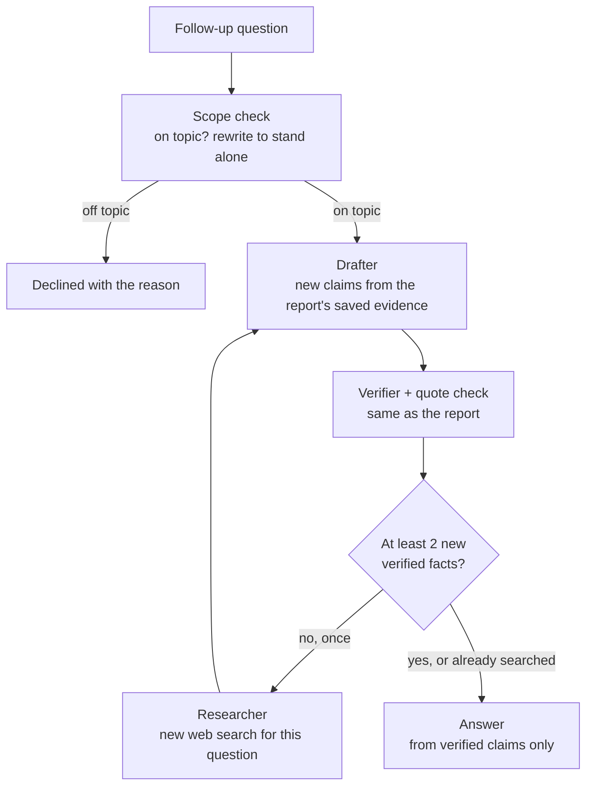

# DeepDive: a self-verifying research analyst

**Agent Arena 2026 · Track 01 (DeepDive).** Ask a research question; get a structured report in
which **every claim has been checked against the exact source text it cites.** Claims the source
doesn't support are removed and listed with the reason, thin areas trigger more research, and
every step of the run is recorded.

Research tools that cite sources already exist. Their known weakness is trust: the cited page
often doesn't say what the sentence claims. DeepDive's focus is making the citations true.

**Measured on 24 research questions, two full runs** ([full results](eval/RESULTS.md)):

| | Latest, with the name check | Same runs, before it | Previous run |
|---|---|---|---|
| Planted false claims caught by the verifier | **96.2%** of 53 | 94.5% of 55 | 87.0% of 54 |
| · of which swapped names | **83.3%** of 12 | 76.9% of 13 | 78.9% of 19 |
| True claims wrongly rejected | **0.0%** of 60 | 0.0% of 60 | 0.0% of 60 |
| Report claims judged grounded by an independent model | **95.0%** of 100 | 94.0% of 100 | 94.0% of 100 |
| Agreement with 50 hand-labelled claims | **86.0%** (Cohen's κ 0.70) | same | same labels |
| Verifier quotes found verbatim in the source | **99.3%** | 99.3% | 99.5% |
| Time per research run | ~4 min | ~4 min | ~4 min |

**Live demo:** https://16.178.82.245.nip.io (sign in with Google to start a run; example reports are public).

## How the agents cooperate



| Agent | Job | Model (via Mesh API) |
|---|---|---|
| **Planner** | Splits the question into 3-6 non-overlapping sub-questions, each with a web query. On a loop, rewrites the query for thin sub-questions using the rejected claims and their reasons. | `openai/gpt-5-nano` |
| **Researcher** ×N | One per sub-question, in parallel: Tavily search → fetch + extract page text → chunk → embed (through Mesh) → store evidence with its source and quality tier. | `google/embeddinggemma-300m` (embeddings) |
| **Drafter** | Writes **atomic claims**, each citing 1-2 evidence chunk ids. Claims citing ids it wasn't given are dropped. | `openai/gpt-5-nano` |
| **Verifier** | Judges each claim against **only** the chunk it cites and must return a **verbatim quote**. | `anthropic/claude-haiku-5.5` (a different model family from the drafter) |
| **Contradictions** | Flags verified claims that disagree across sources, instead of silently picking one. | `openai/gpt-5-nano` |
| **Synthesizer** | Writes the report **from verified claims only**; any paragraph citing anything else is dropped. | `openai/gpt-5-nano` |

The **coordinator** is the LangGraph `StateGraph` in [`app/graph/build.py`](app/graph/build.py).
Graph state carries only ids and counters; sources, chunks, claims, verdicts and events live in
SQLite, and embeddings live in Chroma.

### Follow-up questions reuse the research

Under a finished report, its owner can ask follow-up questions (up to 10 per report, for 30 days).
They run through a second, smaller LangGraph graph with its own loop
([`app/graph/followup.py`](app/graph/followup.py)):



- **Reuses the earlier research.** It searches the chunks the report already collected, and the
  report's verified claims can be cited as they are, so one fact never gets two verdicts.
- **Searches again only when needed.** If the saved evidence gives fewer than 2 new verified facts,
  one web search runs for this question, then the new evidence is drafted and verified.
- **Same guarantees as the report.** Claims the report rejected can't come back; answer paragraphs
  that cite anything unverified or state a figure their claims don't contain are dropped.
- **Stays on topic.** A scope check declines questions about another subject and suggests a new
  report. Follow-ups never change the report itself; they have their own section in the audit trail.

## What makes the verification trustworthy

1. **Quote check in code** ([`app/tools/quote_match.py`](app/tools/quote_match.py)). The
   verifier's quote must actually appear in the cited chunk: normalized exact match, then fuzzy
   match, and *every number in the quote must appear in the source*. If it doesn't, the claim is
   marked unsupported (`verifier quote not found in source`), so the verifier can't hallucinate
   support either. A second code check covers what a valid quote can't: every **name** in the
   claim (organisations, countries, acronyms) must appear in the cited text, so "BloombergNEF
   says…" can't pass on a quote where the IEA says it.
2. **Isolated judging.** The verifier sees one claim and its cited text, nothing else.
3. **A real loop with a rule in code** ([`app/graph/rules.py`](app/graph/rules.py)). A
   sub-question with fewer than 2 supported claims goes back to research with a refined query,
   up to 2 extra rounds. If it's still thin, the report says so under *Limited evidence* rather
   than padding.
4. **Separate drafter and synthesizer.** The writer of the final prose never sees unverified claims, and code
   drops any paragraph citing an unverified claim or stating a figure its cited claims don't contain.
5. **Source-quality tiers** (official/academic → major news → other) order the evidence the
   drafter sees and are shown in the report.

## Self-evaluation

`uv run python -m eval.run` researches the 24 questions in [`eval/questions.jsonl`](eval/questions.jsonl)
and measures:

- **Verifier catch rate.** Supported claims are altered (a number, a year, the direction of a
  change, the named entity) and re-verified against the same source. How many fakes are caught?
- **Wrongful rejection rate.** The same supported claims re-verified unaltered (guards against a
  verifier that rejects everything).
- **Independent groundedness.** A judge from a *third* model family (`google/gemini-2.5-flash-lite`)
  re-checks claims cited in final reports, so the verifier isn't grading its own homework.
- **Agreement with hand labels.** 50 claims labelled by hand against their sources (accuracy and
  Cohen's kappa).
- Quote validity, loop rate, sub-question coverage and time per run.

### Results ([`eval/RESULTS.md`](eval/RESULTS.md), also on the app's `/eval` page)

Two full runs on the same 24 questions. The latest run uses the final configuration; the previous
run differs only in how much of each chunk was embedded for retrieval (1,000 vs 2,400 characters),
which changes the evidence found, not how the verifier judges it. After adding the name check, the
verifier tests were run again on the latest run's stored research (`--skip-research`): same
claims, same sources, new verdicts.

| Metric | Latest + name check | Latest run | Previous run |
|---|---|---|---|
| Runs completed | 24 / 24 | 24 / 24 | 24 / 24 |
| Verifier catch rate, all planted errors | 96.2% of 53 | 94.5% of 55 | 87.0% of 54 |
| · changed number | 100.0% of 12 | 100.0% of 12 | 100.0% of 7 |
| · flipped direction / negation | 100.0% of 19 | 100.0% of 19 | 94.7% of 19 |
| · swapped entity | 83.3% of 12 | 76.9% of 13 | 78.9% of 19 |
| · shifted year | 100.0% of 10 | 100.0% of 11 | 77.8% of 9 |
| Wrongful rejection rate | 0.0% of 60 | 0.0% of 60 | 0.0% of 60 |
| Independent groundedness (Gemini judge) | 95.0% of 100 | 94.0% of 100 | 94.0% of 100 |
| Agreement with hand labels | 86.0% of 50 · κ 0.70 | (same labels) |
| Drafted claims rejected by the verifier | 7.2% (105 of 1,455) | 7.5% (108 of 1,433) |
| Runs that looped back to research | 20.8% | 20.8% |
| Sub-questions ending with enough verified support | 99.1% of 112 | 100% of 115 |
| Time per run (p50 / p95) | 251 s / 353 s | 242 s / 383 s |

**What the numbers say:**
- The catch rate moved from 87.0% to 94.5% between runs. Each run drafts different claims, so a
  different set gets altered: the latest run had fewer entity swaps (the hardest kind), and it
  missed no year or direction changes (the previous run missed 2 and 1). Per-kind samples are small
  (7–19), so treat each figure as an estimate with several points of spread, not an exact value.
- The verifier is strongest where errors are concrete: changed numbers and flipped directions.
  **Swapped entities were the clear weak spot** (about 1 in 4 got through in both runs). The
  verifier would approve "BloombergNEF says X" with a genuine quote where the IEA says X, and
  the quote check passed because the quote really was in the source. A **name check in code**
  ([`missing_names`](app/tools/quote_match.py)) now requires every name in a claim to appear in
  its cited text. Re-measured on the same stored research: swapped names caught 76.9% → 83.3%,
  all planted errors 94.5% → 96.2%, with **no** true claims wrongly rejected (0 of 60).
- Before turning it on, the rule was run over all 2,918 claims the verifier had approved: it
  flags 1.2%. Most are genuine misses where the claim names something the cited chunk doesn't
  (an attribution or a place taken from elsewhere on the page); a few are edge cases such as a
  name cut off at a chunk boundary. Swaps it can't catch are those to a name the same source
  also mentions, and two-letter acronyms that happen to match word initials.
- Against the hand labels, 6 of the 7 disagreements are the verifier being *more lenient* than a
  human, mostly on claims it marked "partial". Partial claims are shown with a warning marker in
  reports for this reason.
- Running the full eval surfaced real bugs: Mesh's 100 requests/minute limit, embedding inputs
  over 2048 tokens, and an empty-reply edge case all failed runs in the first full eval. All three
  are fixed (see [`docs/DESIGN_NOTES.md`](docs/DESIGN_NOTES.md#what-live-runs-taught-us)).

## Run it

```bash
uv sync                                   # Python 3.11, dependencies from uv.lock
cp .env.example .env                      # set MESH_API_KEY and TAVILY_API_KEY
uv run python scripts/mesh_smoke.py       # check every configured model answers
uv run uvicorn app.main:create_app --factory --reload   # http://localhost:8000
```

- One question from the terminal: `uv run python -m app.cli "your question"`
- Sign-in: set `GOOGLE_CLIENT_ID`, `GOOGLE_CLIENT_SECRET` and `SESSION_SECRET` (see
  [`docs/DEPLOY.md`](docs/DEPLOY.md#9-google-sign-in-oauth-client)). Signing in with the
  `CONTACT_EMAIL` account opens the admin area at `/admin`. Mark a run as a public example report
  there or with `uv run python -m app.examples add <run_id>`
- Docker: `docker compose up --build` (data persists in `./data`)
- Tests (no network, no keys): `uv run pytest -q`
- API docs: `/docs` · Live timeline: `/runs/<id>` · Audit trail: `/runs/<id>/trail` (JSON at
  `/api/runs/<id>/trail`)

## Deployment

GitHub Actions → ECR → EC2 (deploy through SSM, no SSH), with Caddy for HTTPS. GitHub
authenticates with an OIDC role when available; on the AWS free plan (no IAM identity providers)
it falls back to a deploy-only IAM user whose key can only push to this repository and send
commands to this one instance. Starting a run needs Google sign-in, each user sees only their own runs (plus public example
reports), each account gets 5 free reports (failed runs don't count), and an hourly run limit
caps cost. Step-by-step: [`docs/DEPLOY.md`](docs/DEPLOY.md).

## Project layout

```
app/graph/       LangGraph coordinator, agent nodes, loop rules, runner
app/tools/       quote matching, source tiers, chunking, search, fetch, vector store
app/llm.py       the only place that calls models, always through Mesh API
app/api/         REST + SSE API, HTML pages, Google sign-in
eval/            question set, planted-error generator, judge, metrics, results
docs/            design notes, deploy runbook
```

Design decisions and trade-offs: [`docs/DESIGN_NOTES.md`](docs/DESIGN_NOTES.md).

## Known limitations

- Single instance: runs and follow-ups execute as in-process background tasks (max 2 at once);
  no job queue.
- Search depends on Tavily's raw page content, falling back to direct fetching. PDFs and
  paywalled pages are skipped, not read.
- Claims are verified; the synthesizer's wording is only checked for citations and figures, so a
  paragraph can still mis-phrase the claims it cites (its citations make that checkable).
- The verifier checks support against the cited chunk, not whether the source itself is correct.
  Source tiers and contradiction flags help, but a wrong official figure stays wrong.
- Eval questions are answered from the live web, so numbers vary between runs. Search results are
  cached to keep re-runs reproducible.
